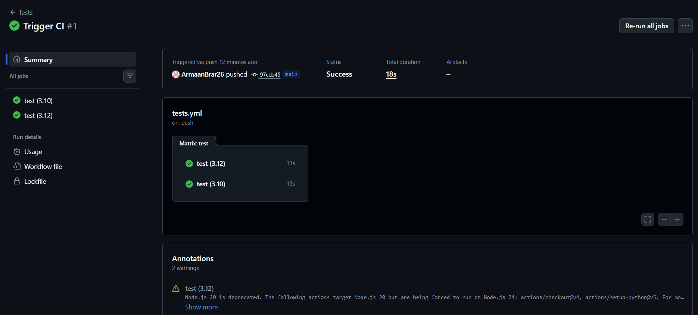

# Defects, Fixes and Test Results

**Summary:** 10 defects fixed (8 in `cart.py`, 2 in `repository.py`), 30 new test cases (21 test functions) plus the 2 provided smoke tests, and a GitHub Actions workflow that runs `python -m pytest -q` on every push and pull request.

---

## Part 1: Defects fixed

### cart.py

| # | Defect | Where | What could go wrong | How it was fixed it |
|---|---|---|---|---|
| 1 | No quantity validation when adding items | `ShoppingCart.add_item` | A negative quantity passed the stock check (`stock < -5` is false), creating a line with a negative quantity and a negative subtotal. Zero, floats, strings and `None` were also accepted or raised `TypeError`. | Added a `_valid_quantity` helper that accepts only integers greater than 0 (booleans are rejected). It runs before any database call, and invalid input returns `False` with an "Invalid quantity" message. |
| 2 | Stock check ignored what was already in the cart | `ShoppingCart.add_item` | Each add was compared to stock on its own. With 5 laptops in stock, adding 3 and then 3 again was accepted, leaving 6 laptops in the cart. | The check is now `quantity already in cart + new quantity > stock`, which covers both new lines and repeated adds of the same SKU. |
| 3 | No validation when removing items | `ShoppingCart.remove_item` | A negative removal quantity made `line.quantity -= quantity` increase the quantity. Zero and non-integer values were also accepted or crashed. | Removal quantities must be `None` (remove the whole line) or a positive integer, using the same helper as #1. |
| 4 | Discounts stacked and compounded | `ShoppingCart.apply_discount` | The discount started from `self.total()`, which returned the already-discounted total. Applying `WELCOME10` twice gave 20% off, and `WELCOME10` followed by `STUDENT20` took 10% and then 20% off the reduced price. | Discounts are always computed from the current `subtotal()`, and only one coupon is stored. Applying a new valid coupon replaces the old one. |
| 5 | Stale discount after the cart was edited | `apply_discount` / `total` | The discounted amount was cached in `discounted_total`. If a user applied a coupon and then added or removed items, the total stayed at the old value. | Removed the cached number. The cart now stores only `discount_code`, and `total()` recomputes from the current subtotal each time. |
| 6 | `SAVE15` could make the total negative | `apply_discount` | A cart worth less than $15 (for example, one USB cable at $9.99) produced a negative total. | The result is floored with `max(0, subtotal - 15)`. |
| 7 | Floating-point errors in money | `subtotal` / `total` | Binary floats produced values such as `2999.9700000000003` for three laptops and `899.991` for 10% off one laptop. These unrounded values would be sent to the payment gateway and saved in the database. | `subtotal()` and `total()` now round to 2 decimal places. |
| 8 | Repeated `load()` duplicated items | `ShoppingCart.load` | `load()` added saved items on top of the existing cart lines, so each call doubled the quantities. | `self.lines.clear()` runs before loading, so repeated loads give the same result. |

### repository.py

| # | Defect | Where | What could go wrong | How it was fixed it |
|---|---|---|---|---|
| 9 | SQL injection | `get_product`, `get_saved_cart` | The SKU and user ID were inserted into the SQL text with f-strings. An input such as `x' OR '1'='1` changed the query, and in `get_saved_cart` it could return other users' saved carts. | Both queries now use parameterized placeholders (`WHERE sku = ?`, `WHERE user_id = ?`) with the value passed separately. |
| 10 | Stock could go negative | `update_stock` | The update never checked that enough stock existed, so stock could drop below zero (for example 5 - 6 = -1) and the caller was never told. | The update is now conditional (`UPDATE ... WHERE sku = ? AND stock >= ?`) and returns `True` only if a row was changed (`rowcount == 1`). |

---

## Part 2: Assumptions

- **Quantities** must be whole numbers greater than 0. Booleans, floats, strings and `None` are rejected.
- **Only one coupon** can be active at a time. Applying a new valid coupon replaces the previous one, and an invalid code leaves the existing coupon unchanged.
- **`FREESHIP`** leaves the price unchanged because the application does not model shipping costs. It is still accepted as a valid code.
- **Coupon codes** are case-sensitive and exact, as in the original code.
- **Money** is rounded to 2 decimal places with Python's `round()`.
- **Stock is checked when items are added to the cart** (including everything already in the cart). Stock is not re-checked at checkout;
- **The payment gateway** was kept as the supplied `FakePaymentGateway`, and none of the tests use real payment data.

---

## Part 3: Test results

Tests are in `tests/test_cart.py` (15 test functions), `tests/test_repo.py` (6 test functions) and the 2 provided smoke tests in `tests/test_smoke.py`. Parametrized tests run once per input, so pytest reports 32 tests in total. Every test uses a temporary SQLite database created by `tmp_path` and never touches `shop.db`.

| Defect | Test(s) that prove the fix |
|---|---|
| 1. Add quantity validation | `test_add_item_rejects_invalid_quantity` |
| 2. Stock vs. cart contents | `test_repeated_adds_cannot_exceed_stock` |
| 3. Remove validation | `test_remove_rejects_invalid_quantity` |
| 4. Stacking discounts | `test_discounts_do_not_stack` |
| 5. Stale discount | `test_discount_updates_when_cart_is_edited` |
| 6. `SAVE15` negative | `test_save15_never_goes_negative`, `test_save15_boundary_just_above_15` |
| 7. Float money | `test_subtotal_is_rounded_to_cents`, `test_discounted_total_is_rounded_to_cents` |
| 8. Repeated `load()` | `test_repeated_load_does_not_duplicate_items` |
| 9. SQL injection | `test_get_product_is_not_vulnerable_to_sql_injection`, `test_get_saved_cart_is_not_vulnerable_to_sql_injection` |
| 10. Negative stock | `test_update_stock_rejects_more_than_available`, `test_update_stock_decrements_when_enough_stock`, `test_update_stock_can_take_all_remaining_stock` |

Supporting tests for normal behavior: `test_add_valid_item_creates_line`, `test_adding_same_sku_merges_into_one_line`, `test_remove_partial_and_full_quantity`, `test_invalid_coupon_is_rejected_and_changes_nothing`, `test_save_then_load_restores_cart`, `test_get_product_returns_seeded_product`.

### Result of `python -m pytest -q`

```
................................        [100%]
32 passed in 1.80s
```

---

## Part 4: GitHub Actions

The workflow is `.github/workflows/tests.yml`. It runs on every push and pull request, sets up Python (3.10 and 3.12), installs `requirements.txt`, and runs `python -m pytest -q`.

- **Successful run:** https://github.com/ArmaanBrar26/COMP7082-Assignment4/actions/runs/44834693767
- **Screenshot:** 

Note: my first push showed a failed run. GitHub refused to start it because of an account billing restriction (before any workflow step executed), not because of the code. After resolving the restriction, I re-triggered the workflow with a new commit and it completed successfully.

---

## Part 5: Defects identified but not fixed

These were found while reviewing the code but are outside the 10 defects I chose to fix. They are listed so the remaining risks are documented.

**checkout.py**
- **Stock is decremented before payment and never restored.** If the payment is declined or raises an exception, inventory is already reduced for an order that did not happen. A fix would verify stock, charge, and only then decrement (or restore stock on failure).
- **A declined or failed payment still clears the cart.** The user loses their cart and cannot retry.
- **No idempotency.** A repeated checkout with the same `request_id` charges the customer twice. A missing `request_id` only prints a message. A fix would require the ID and return the existing order if one is found.
- **The payment token is printed** (`Charging payment token: ...`), which leaks a sensitive value into logs.
- **The return value of `update_stock` is ignored,** so the stock protection added in defect 10 is not yet used by checkout.
- **A coupon is not cleared after checkout.** The line `cart.discounted_total = None` no longer has any effect because the cart now tracks `discount_code`.

**repository.py**
- **`list_orders` ignores `user_id`** and returns every user's orders.
- **Database connections are not closed if an error occurs.** 
- **`save_order` does not enforce unique request IDs** 
